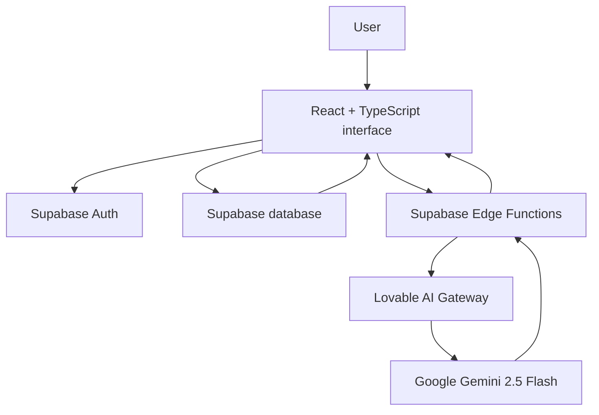

# AthleTech — Heart-Safe Fitness Assistant

AthleTech is a fitness application for planning workouts, recording training sessions, and monitoring fitness progress. It combines personalized workout generation with exercise-safety guidance and health-focused dashboards.

## What It Includes

- **Account and onboarding:** Supabase authentication, protected pages, and onboarding for fitness level, goals, body metrics, and workout preferences.
- **Personalized workouts:** Generate plans from a user's experience, goals, preferred muscle groups, available equipment, and session duration.
- **Workout tracking:** Follow an active session, record sets/reps/weights and rest periods, and review a workout summary.
- **Progress views:** Workout statistics, progress analytics, and progress-photo management.
- **Health and safety:** Heart-health and health dashboards, plus a safety-alert area.
- **AI safety tips:** Request exercise-specific guidance using exercise and user-context information.

## Application Flow



The two Edge Functions are `generate-workout` and `generate-safety-tip`. Workout generation returns a structured plan with exercises, sets, reps, rest periods, instructions, warm-up, and cool-down. Safety-tip generation returns concise exercise-specific guidance.

## Technology Stack

| Area | Tools |
|---|---|
| Frontend | React 18, TypeScript, Vite |
| UI and styling | Tailwind CSS, Radix UI / shadcn-style components, Lucide |
| Routing and data | React Router, TanStack Query |
| Backend services | Supabase Auth, database, Edge Functions |
| AI features | Lovable AI Gateway with Google Gemini 2.5 Flash |
| Forms and validation | React Hook Form, Zod |
| Charts | Recharts |

## Run Locally

**Prerequisites:** Node.js 18+ and npm.

```bash
git clone https://github.com/SujalRevankar/AthleTech-Heart-Safe-Fitness-Assitant.git
cd AthleTech-Heart-Safe-Fitness-Assitant
npm install
npm run dev
```

Vite prints the local development URL in the terminal. Useful project scripts:

```bash
npm run build
npm run lint
npm run preview
```

The Supabase client is configured in `src/integrations/supabase/client.ts`. The Edge Functions require the `LOVABLE_API_KEY` secret in their Supabase environment. When using a different Supabase project, configure its client and backend resources accordingly. Never place a service-role key or AI gateway secret in browser code.

## Main Project Structure

```text
src/
  components/       Reusable UI and layout components
  contexts/         Authentication context
  hooks/            Shared data and statistics hooks
  integrations/     Supabase client and generated types
  pages/
    auth/           Login, signup, password recovery
    onboarding/     Fitness assessment and preferences
    workout/        Plans, active sessions, summaries
    progress/       Overview, analytics, photos
    health/         Health and heart-health views
    safety/         Safety alerts
    profile/         Profile pages
    settings/        Application settings
    premium/         Subscription page
  App.tsx            Routes and providers

supabase/
  functions/
    generate-workout/
    generate-safety-tip/
```

## Notes

The health and safety screens provide fitness-oriented information and guidance; this application is not a medical device and does not replace professional medical advice. AI-generated workout suggestions should be reviewed and adapted to the user's needs.
