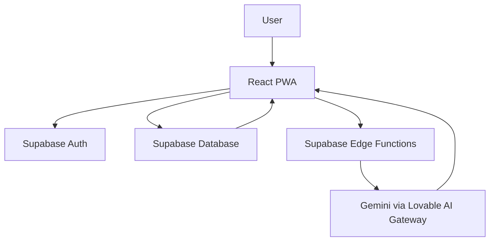

# AthleTech – AI-Powered Fitness Assistant

AthleTech is a fitness training Progressive Web App (PWA) focused on personalized workouts, progress tracking, and safer exercise routines.

## Features
- Supabase authentication and user onboarding
- AI-generated workout plans and exercise safety tips
- Workout sessions with set, rep, weight, and rest-time tracking
- Progress dashboards, analytics, and progress photos
- Heart-health insights, safety alerts, and recovery tracking

## Tech Stack
React 18 · TypeScript · Vite · Tailwind CSS · Radix UI · Supabase · TanStack Query · Recharts · Zod

## Architecture


## Run Locally
**Prerequisites:** Node.js 18+ (or Bun) and access to the configured Supabase project.

```bash
git clone https://github.com/SujalRevankar/AthleTech-Heart-Safe-Fitness-Assitant.git
cd AthleTech-Heart-Safe-Fitness-Assitant
npm install
npm run dev
```

Use the environment configuration expected by the Supabase integration. Do not commit secrets or API keys.

## Notes
AI workout and safety features are intended as fitness support, not medical diagnosis or a substitute for professional advice.
